<div align="center">

# AI Hunter-News

**The AI world, briefed for developers.**

Live AI news from 15 trusted sources, curated GitHub repositories, and a role-based learning hub
(available as a website, an installable PWA, and a desktop app).

[**Live site →**](https://ai-hunter-news.netlify.app)


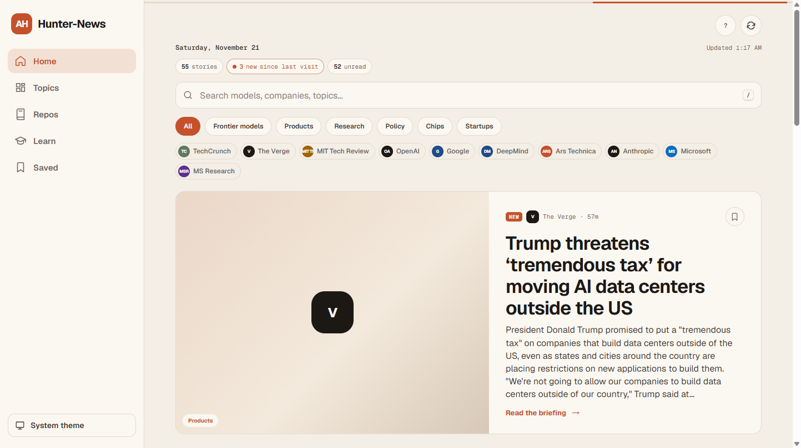

</div>

---

## Contents

- [Features](#features)
- [Screenshots](#screenshots)
- [Architecture](#architecture)
- [How it works](#how-it-works)
- [Getting started](#getting-started)
- [Scripts](#scripts)
- [Deployment](#deployment)
- [Project structure](#project-structure)
- [Search syntax](#search-syntax)
- [Keyboard shortcuts](#keyboard-shortcuts)
- [Testing](#testing)
- [Maintaining the content](#maintaining-the-content)
- [Privacy](#privacy)
- [Author](#author)

---

## Features

### 📰 News feed
- **Live news from 15 sources:** TechCrunch, The Verge, MIT Technology Review, Ars Technica, IEEE Spectrum, Interconnects, OpenAI, Anthropic, Google AI, Google DeepMind, Microsoft, Microsoft Research, Hugging Face, Mistral and NVIDIA.
- **Six topics,** sorted automatically by keyword rules: Frontier models, Products, Research, Policy, Chips and Startups.
- **"New since your last visit" badges,** **read tracking** with an *Unread only* filter, and **source filter** chips.
- **Time-grouped sections:** Last hour, Today, Yesterday, This week, Earlier.
- **Saved stories,** a **share** button (the native share sheet on phones), and **pull to refresh**.
- **Works offline:** the last edition is cached on the device, with a bundled fallback edition.

### 🔍 Search
- **Ranked results:** title matches rank above source/topic matches, which rank above summary matches, with a small boost for fresh stories.
- **Word-prefix matching** (`clau` → Claude), **highlighted matches** and **summary snippets**.
- **Advanced syntax:** `source:verge`, `topic:policy`, `"exact phrase"` and `-exclude`.
- **Developer aliases:** `llm` → "language model", `oss` → "open source", `funding` → "raises".
- **Recent searches,** **trending terms** with counts, and the `/` / `Ctrl+K` shortcuts.

### ⭐ AI repos
- **50 hand-picked, verified GitHub repositories** in six groups: Coding agents, LLMs from scratch, Courses & cookbooks, Agent frameworks, Run & fine-tune, and MCP.
- **13 people shaping AI,** including Andrej Karpathy, Andrew Ng, Addy Osmani, Sebastian Raschka, Jeremy Howard, Simon Willison, Chip Huyen, Georgi Gerganov and others, each with a profile card.
- **Live stars and activity** from the GitHub API, a **Rising this month** strip, sorting, search and a one-click `git clone` copy button.

### 🎓 Learn
- **Certifications, courses and learning sites** for **Developers, Testers & QA, Architects, Forward deployed engineers** and **Getting started**.
- **Providers:** Anthropic, OpenAI, Microsoft, GitHub, Google, AWS, ISTQB, NVIDIA, Databricks, Hugging Face, DeepLearning.AI, Coursera, fast.ai, MDN and more.
- **A suggested path for each role,** with on-device progress tracking.
- **Clear cost labels** (*Free*, *Free to learn* or *Exam*), exam codes and levels. Every link and its status was checked; retired certifications are excluded.

### 📱 Runs everywhere
- **Responsive layouts** for phone portrait and landscape, tablet, iPad and desktop, with iPhone safe-area support.
- **Light and dark themes** that follow the system, a manual toggle, and no flash on load.
- **Installable PWA** with offline support and auto-updates.
- **Desktop app** for Windows, macOS and Linux, built with Electron.

---

## Screenshots

| Search (desktop, dark) | AI repos (desktop) |
|---|---|
| 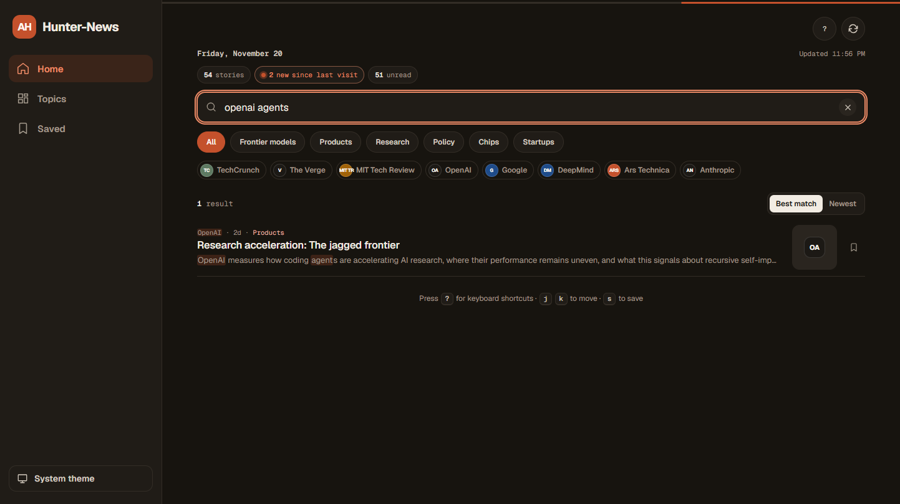 | 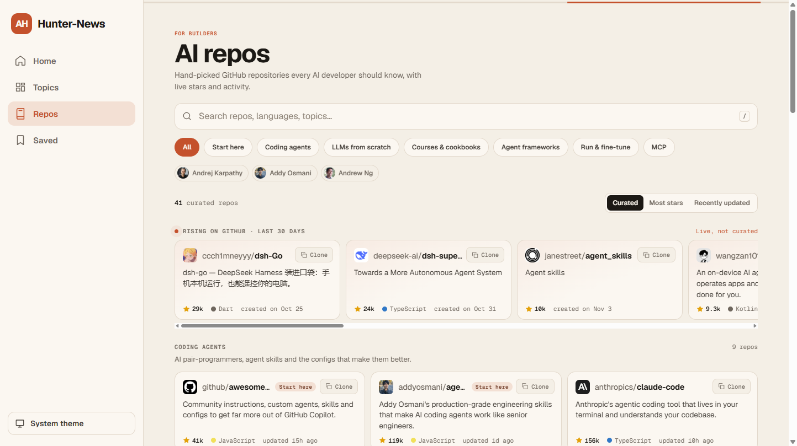 |
| **Learn: forward deployed engineer path** | **Keyboard shortcuts** |
| 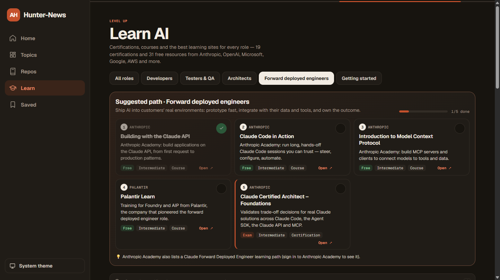 | 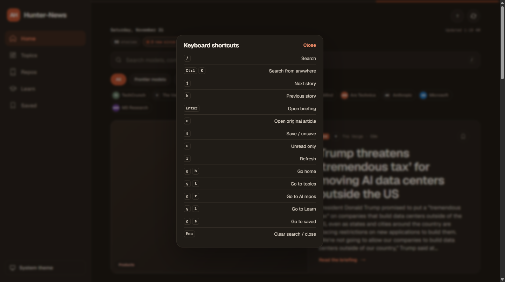 |

| Home (mobile) | Search suggestions (mobile, dark) | Learn (mobile) |
|---|---|---|
| 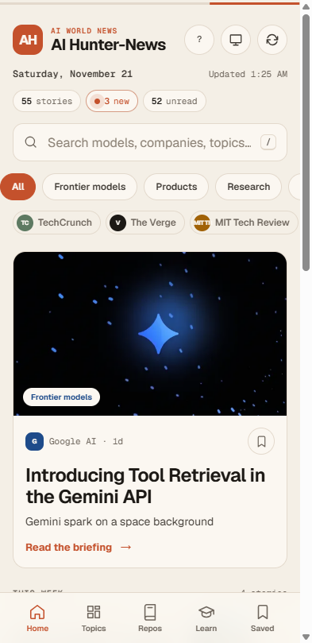 | 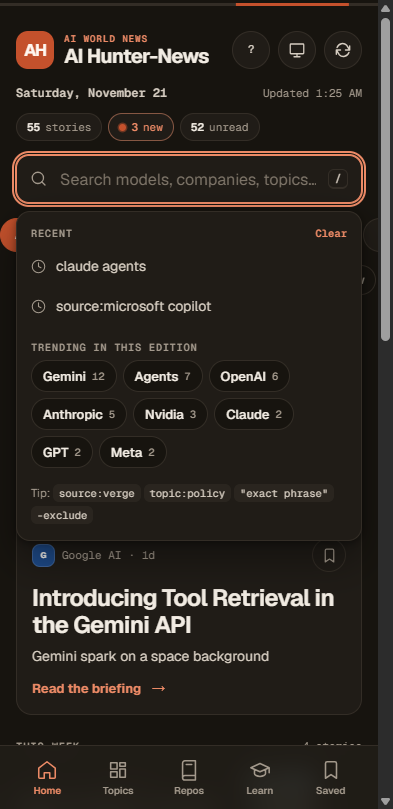 | 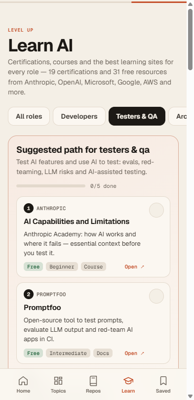 |

---

## Architecture

AI Hunter-News is a **single-page React app with no database and no user accounts**. Publisher feeds need a small proxy, because browsers block cross-site feed requests (CORS). The same proxy logic runs in three places, depending on how the app is used.

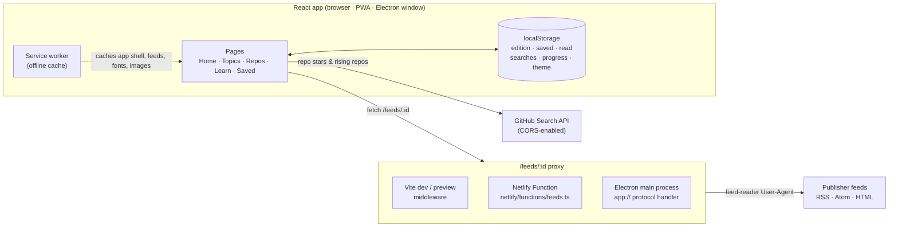

| Layer | Technology |
|---|---|
| UI | React 18, React Router 7, TypeScript 5 |
| Build | Vite 6 |
| Styling | Hand-written CSS with design tokens (light/dark); Geist and Geist Mono fonts |
| PWA | `vite-plugin-pwa` (Workbox), generated icons |
| Desktop | Electron with a custom `app://` protocol; packaged with `electron-builder` |
| Hosting | Netlify (static site + one serverless function) |
| Tests | Node's built-in test runner via `tsx`, with `jsdom` |

---

## How it works

### Loading the news edition

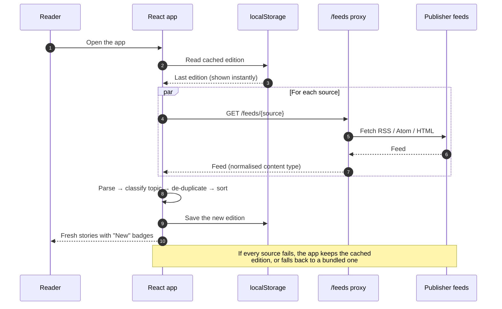

### Story processing pipeline

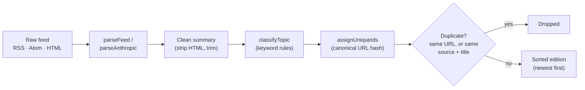

### Search

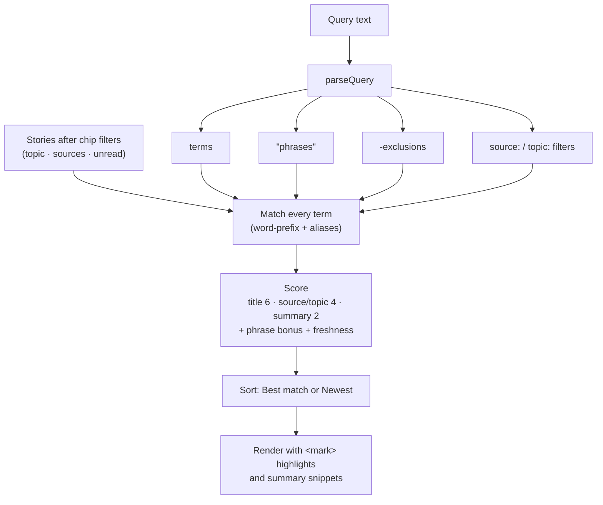

### AI repos data

Live data comes straight from the browser. A single GitHub search with `repo:` qualifiers returns every curated repo, so each page view uses **at most 2 requests**, well within GitHub's unauthenticated limit of 10 a minute.

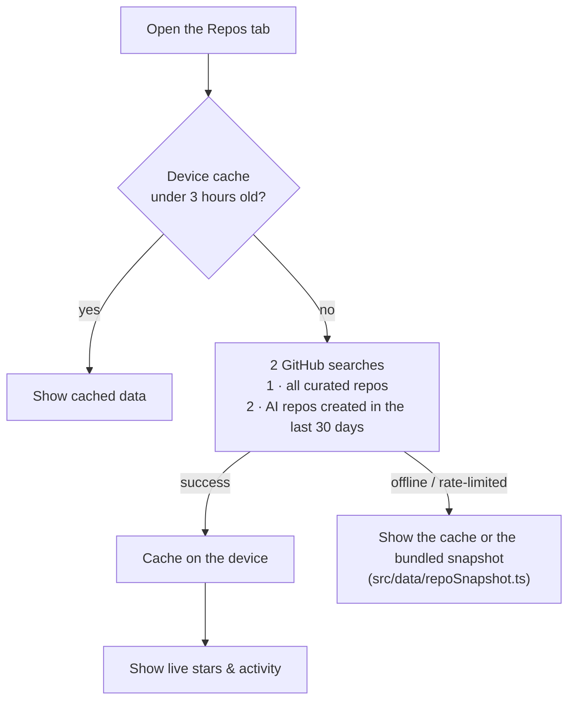

### Where the app runs

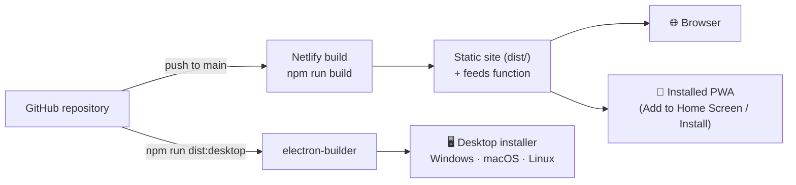

> **Desktop storage:** the Electron app serves pages from a fixed `app://hunter-news` origin instead of a localhost port that changes on every launch. Browser storage is tied to the origin, so saved stories, reading progress and settings survive restarts.

---

## Getting started

### Prerequisites
- **Node.js 20+** and npm

### Install and run

```bash
git clone https://github.com/RoshanMali1205/ai-hunter-news.git
cd ai-hunter-news
npm install
npm run dev
```

Open **http://127.0.0.1:5173**. The dev server includes the `/feeds` proxy, so live news works right away.

### Try it on your phone (same Wi-Fi)

```bash
npm run preview:lan
```

Open the **Network** URL it prints on your phone. Phones only allow installing a PWA over HTTPS, so use the deployed site to test installation.

### Run the desktop app

```bash
npm run desktop       # build and open the desktop app
npm run desktop:dev   # desktop app with live reload
```

---

## Scripts

| Command | What it does |
|---|---|
| `npm run dev` | Start the Vite dev server with the feed proxy |
| `npm run build` | Type-check and build the production site into `dist/` |
| `npm run preview` | Serve the production build locally (with the feed proxy) |
| `npm run preview:lan` | Build and serve on your local network for phone testing |
| `npm test` | Run the test suite |
| `npm run desktop` | Build and launch the Electron desktop app |
| `npm run desktop:dev` | Launch the desktop app against the dev server |
| `npm run dist:desktop` | Build a desktop installer into `release/` |
| `npm run generate-icons` | Regenerate PWA icons from `public/favicon.svg` |
| `npm run repos:snapshot` | Refresh the offline snapshot of curated GitHub repos |

---

## Deployment

### Netlify (web + PWA)

All settings are in [`netlify.toml`](netlify.toml), so connecting the repository is enough:

1. In Netlify, choose **Add new site → Import from Git** and pick this repository.
2. Deploy. Netlify runs `npm run build`, publishes `dist/`, and deploys `netlify/functions/feeds.ts` at `/feeds/:id`.

The config also:
- uses Node 20 and skips the Electron binary download during the build;
- routes every page path to `index.html` for client-side routing;
- serves `sw.js` uncached and the manifest as `application/manifest+json`.

Pull requests get **deploy previews**, which are useful for checking the feed function before merging.

### Desktop installers

```bash
npm run dist:desktop
```

Output goes to `release/`: an NSIS installer on Windows, a DMG on macOS and an AppImage on Linux. Build each platform on that operating system or in CI. The installers aren't code-signed, so Windows SmartScreen and macOS Gatekeeper will show a warning.

---

## Project structure

```text
ai-hunter-news/
├── electron/
│   └── main.mjs              # Desktop app: app:// protocol, feed proxy, window
├── netlify/functions/
│   └── feeds.ts              # Serverless feed proxy for /feeds/:id
├── scripts/
│   ├── export-sources.ts     # Writes feed URLs + user agent for Electron
│   └── snapshot-repos.ts     # Refreshes the GitHub repo snapshot
├── src/
│   ├── components/           # Pages and UI (HomePage, ReposPage, LearnPage, …)
│   ├── data/
│   │   ├── sources.ts        # Publishers, topics, feed user agent
│   │   ├── repos.ts          # Curated repos, categories, people
│   │   ├── repoSnapshot.ts   # Generated offline fallback for repos
│   │   ├── learning.ts       # Certifications, courses, learning sites, role paths
│   │   └── fallback.ts       # Bundled edition for when every feed fails
│   ├── lib/
│   │   ├── fetchEdition.ts   # Loads and merges all feeds
│   │   ├── parseFeed.ts      # RSS / Atom / HTML parsing
│   │   ├── classify.ts       # Keyword topic classification
│   │   ├── search.ts         # Query parser, ranking, highlighting
│   │   ├── github.ts         # GitHub search client
│   │   ├── activity.ts       # Read state, last visit, recent searches
│   │   └── …                 # theme, storage, time, keyboard, pull-to-refresh
│   ├── App.tsx               # Routes and app state
│   └── styles.css            # Design tokens, themes, responsive layouts
├── tests/                    # Parsers, search, repos and learning tests
├── netlify.toml
└── vite.config.ts            # Vite, PWA and dev feed proxy
```

---

## Search syntax

| Query | Finds |
|---|---|
| `claude agents` | Stories matching **every** word, including partial words (`clau` works) |
| `"open source"` | The exact phrase |
| `gemini -pixel` | Gemini stories that don't mention Pixel |
| `source:verge` | Stories from one publisher (id or name prefix) |
| `topic:policy` | Stories in one topic (id or label prefix) |
| `source:openai topic:research agents` | All of the above combined |

---

## Keyboard shortcuts

Press `?` anywhere in the app to see them all.

| Keys | Action |
|---|---|
| `/` or `Ctrl` + `K` | Search |
| `j` / `k` | Next / previous story |
| `Enter` | Open the briefing |
| `o` | Open the original article |
| `s` | Save / unsave |
| `u` | Unread only |
| `r` | Refresh |
| `g` then `h` / `t` / `r` / `l` / `s` | Go to Home / Topics / Repos / Learn / Saved |
| `Esc` | Clear search / close |

---

## Testing

```bash
npm test
```

**37 tests** covering:
- feed parsing (RSS, Atom, the Anthropic HTML page), canonical URLs and de-duplication;
- the search parser, ranking, aliases, highlighting and snippets;
- the GitHub client (batching, errors, rising-repo filtering) with a mocked `fetch`;
- **content guards:**
  - every curated repo exists in the snapshot and isn't archived;
  - every person has repos;
  - every learning path points at real items;
  - retired certification exams stay out of the list.

---

## Maintaining the content

| Content | Where | How to update |
|---|---|---|
| News sources | `src/data/sources.ts` | Add a source with its feed URL and format, add its id to `SourceId` (`src/types.ts`) and `sourceNameForBriefing` (`src/lib/briefing.ts`), then `npm test` |
| Curated repos and people | `src/data/repos.ts` | Edit the lists, run `npm run repos:snapshot`, then `npm test` |
| Certifications and courses | `src/data/learning.ts` | Check the provider's page, update `LEARNING_VERIFIED_ON`, then `npm test` |

> Certifications change often: exams get renamed, new versions appear and old ones retire. Re-check `learning.ts` every few months. The Learn page shows readers the date it was last checked.

---

## Privacy

- **No accounts, no analytics, no backend database.**
- Saved stories, read history, recent searches, learning progress and the theme choice live **only in your browser's local storage** on your device.
- The feed proxy forwards requests to publishers and doesn't store anything.
- Stories link to the original publishers; full articles stay on their sites.

---

## Author

Designed and developed by **[Roshan Mali](https://github.com/RoshanMali1205)**.

If you find the project useful, a ⭐ on the repository is appreciated.
